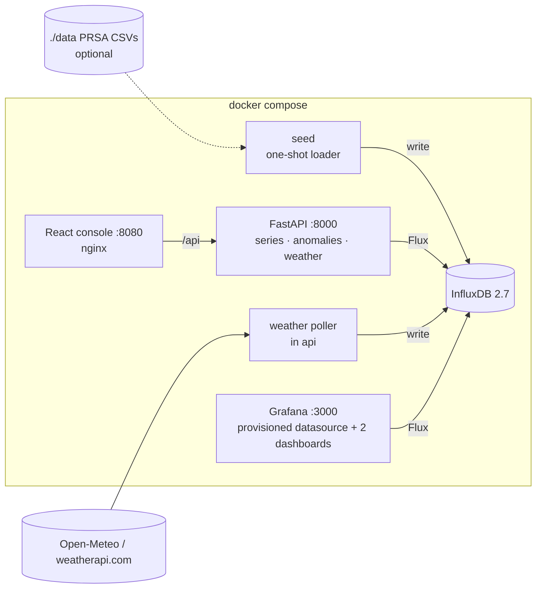
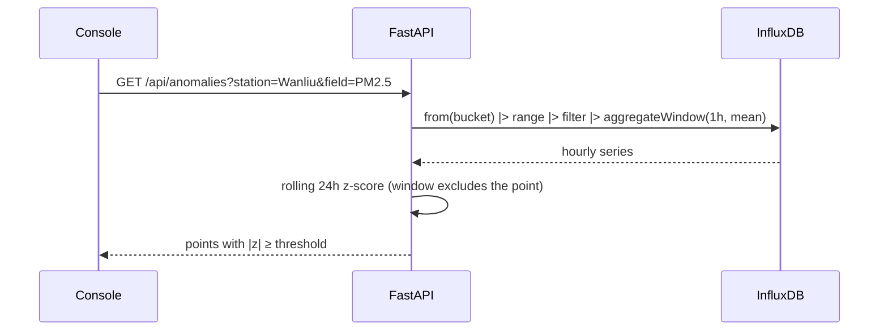

# 📈 Time-Series Analytics: InfluxDB · Grafana · Python

<p align="center"></p>

> Collect, store, explore and visualise time-series data with **InfluxDB 2 (Flux)**, **Grafana** dashboards that are
> provisioned automatically, and a **FastAPI + React** console that adds anomaly detection and live ingestion.
> One `docker compose up`, nothing to click through.


---

## 1. The idea

Time-series databases are built for timestamped, append-heavy data. They give you cheap retention, time-window aggregation and fast range scans. This project puts two data feeds through one stack:

| Feed | Source | Measurement / bucket |
|---|---|---|
| Hourly air quality, Beijing PRSA schema (PM2.5, PM10, NO2, O3, TEMP, WSPM…) | **Synthetic** by default; real [UCI PRSA CSVs](https://archive.ics.uci.edu/dataset/501/beijing+multi+site+air+quality+data) if you mount them | `air_quality` / `air-quality` |
| Live current weather | **Real**: weatherapi.com if `WEATHERAPI_KEY` is set, otherwise keyless [Open-Meteo](https://open-meteo.com) | `api` / `weather` |

## 2. Architecture

<p align="center"></p>





## 3. Run it

```bash
cp .env.example .env     # optional; every value has a local default
docker compose up --build
```

| URL | What |
|---|---|
| http://localhost:3000 | Grafana (anonymous viewer; admin/admin to edit, local default) |
| http://localhost:8080 | React console |
| http://localhost:8000/docs | API |
| http://localhost:8086 | InfluxDB UI (my-user / my-password, local only) |

```bash
docker compose down        # add -v to wipe the InfluxDB/Grafana volumes
```

**Real air-quality data:** download the UCI dataset, put the CSVs in `data/PRSA_Data_20130301-20170228/`, run `docker compose down -v && docker compose up`, then set the dashboard time range to 2013–2017.

## 4. The console (beside Grafana)

Grafana does the dashboards. The console adds what Grafana doesn't show out of the box: **anomaly detection** with an adjustable threshold, a station comparison table, an honest data-source label, and a **Collect now** button for live weather.


## 5. Grafana, provisioned as code

- `grafana/provisioning/datasources/influxdb.yml` sets up the Flux datasource. The token and org come from env.
- `grafana/dashboards/air-quality.json` has a `station` variable (from `schema.tagValues`), latest-PM2.5 stat tiles with AQI-style thresholds, PM2.5/PM10/temperature/wind/NO2-vs-O3 panels, and `aggregateWindow(v.windowPeriod)`.
- `grafana/dashboards/live-weather.json` holds the polled real observations and refreshes every 1 minute.


> ⚠️ **Honest data labels.** The air-quality values in these screenshots are **synthetic**: the generator follows the PRSA schema and injects pollution spikes. The console and `/health` (`air_quality_data`) say so. The weather values are **real Open-Meteo observations for Toronto**. The screenshot shows a single point because the stack had only just started (one poll every 5 minutes).

## 6. API

| Method | Path | Purpose |
|---|---|---|
| GET | `/health` | InfluxDB status, data mode (synthetic/real), weather source, last poll or error |
| GET | `/api/stations` | Station tags and fields |
| GET | `/api/series` | Hourly (or `every`) mean for a station and field |
| GET | `/api/anomalies` | Rolling z-score anomalies (`window`, `threshold`) |
| GET | `/api/summary` | Mean/max/count per station |
| GET / POST | `/api/weather`, `/api/weather/collect` | Read the live series / record one real observation (`502` and nothing written on failure) |

Query parameters are validated before they go into Flux (station pattern, field whitelist, `-7d`-style ranges).


## 7. What changed from the original scripts

- `src/*.py` were moved to `legacy/src/`. The logic now lives in `tsa/` (pure transforms, Influx I/O, seeder, weather).
- Bugs fixed:
  - `api_client.py` read a non-existent `src/config.json` and `config['bucket']`.
  - It stamped local time with a hard-coded `+12:00` offset.
  - `insert_data.py` passed the tag list as `data_frame_field_columns`, so no numeric fields were written to `test`.
- Compose: the deprecated `version: '2'` and `latest` image tags are gone, and the stale InfluxDB 1.x env vars in Grafana were dropped. Bind-mount data/config dirs (which needed `chmod -R 777 ~/`) became named volumes. A fixed local admin token is set, so nothing has to be copied by hand.
- `requirements.txt` was replaced by uv with `pyproject.toml` and `uv.lock`.
- The original README and screenshots are in [docs/ORIGINAL_README.md](docs/ORIGINAL_README.md). Batch-ingestion notes are in [docs/BESTPRACTICES.md](docs/BESTPRACTICES.md).

## 8. Quality

- `uv run pytest`: transforms (PRSA parsing, UTC handling, deterministic synthetic data, z-score), API (Flux-injection guards, anomaly maths, failed collection writes nothing, degraded health) and the Grafana provisioning files. No InfluxDB or network needed.
- CI: tests, then the frontend build, then `docker compose build`.
- `uv run --no-project --with playwright python scripts/screenshots.py` regenerates every screenshot from the running stack.
