# 📈 Time-Series Analytics: InfluxDB · Grafana · Python

<p align="center"></p>

> Collect, store, explore and visualise time-series data with **InfluxDB 2 (Flux)**, **Grafana** dashboards that are
> provisioned automatically, and a **FastAPI + React** console that adds anomaly detection and live ingestion.
> One `docker compose up`, nothing to click through.

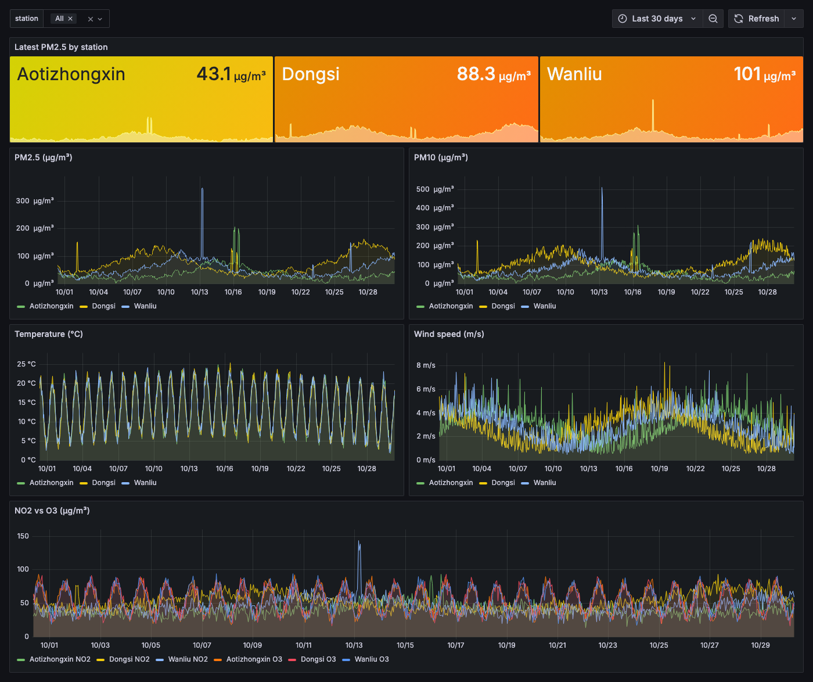

---

## Business case

Sensor readings often sit in spreadsheets until a spike causes a complaint. This stack stores readings in InfluxDB, charts them in Grafana dashboards defined as code, and flags unusual values with a rolling z-score. It suits facilities, environment and small industrial teams that want early warnings without a large platform. [docs/BUSINESS_CASE.md](docs/BUSINESS_CASE.md) covers the use cases, an illustrative ROI model and the limits.

## 1. The idea

Time-series databases are built for timestamped, append-heavy data. They give you cheap retention, time-window aggregation and fast range scans. This project puts two data feeds through one stack:

| Feed | Source | Measurement / bucket |
|---|---|---|
| Hourly air quality, Beijing PRSA schema (PM2.5, PM10, NO2, O3, TEMP, WSPM…) | **Synthetic** by default; real [UCI PRSA CSVs](https://archive.ics.uci.edu/dataset/501/beijing+multi+site+air+quality+data) if you mount them | `air_quality` / `air-quality` |
| Live current weather | **Real**: weatherapi.com if `WEATHERAPI_KEY` is set, otherwise keyless [Open-Meteo](https://open-meteo.com) | `api` / `weather` |

## 2. Architecture

<p align="center"></p>

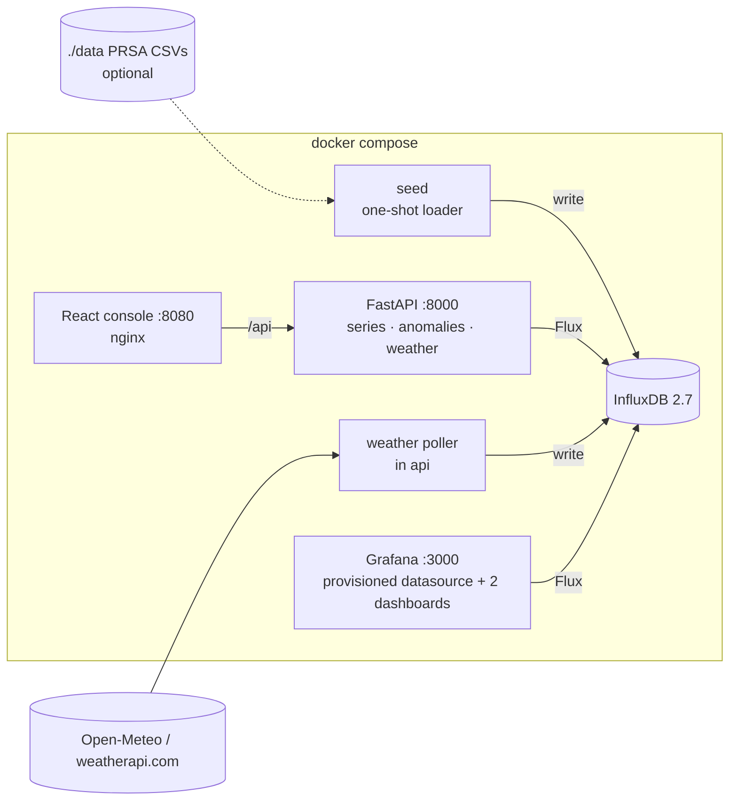

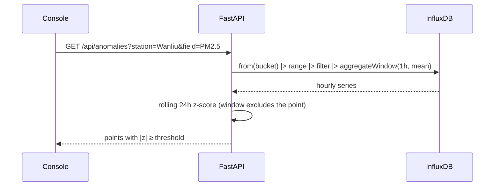

## 3. Run it

```bash
cp .env.example .env     # optional; every value has a local default
docker compose up --build
```

| URL | What |
|---|---|
| http://localhost:3000 | Grafana (anonymous viewer; admin/admin to edit, local default) |
| http://localhost:8080 | React console |
| http://localhost:8000/docs | API |
| http://localhost:8086 | InfluxDB UI (my-user / my-password, local only) |

```bash
docker compose down        # add -v to wipe the InfluxDB/Grafana volumes
```

**Real air-quality data:** download the UCI dataset, put the CSVs in `data/PRSA_Data_20130301-20170228/`, run `docker compose down -v && docker compose up`, then set the dashboard time range to 2013–2017.

## 4. The console (beside Grafana)

Grafana does the dashboards. The console adds what Grafana doesn't show out of the box: **anomaly detection** with an adjustable threshold, a station comparison table, an honest data-source label, and a **Collect now** button for live weather.

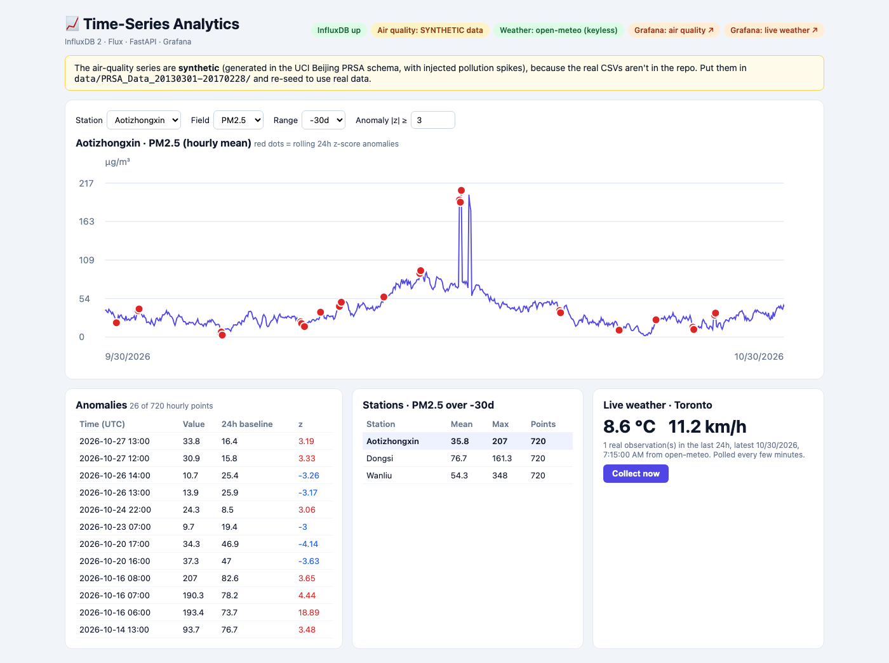

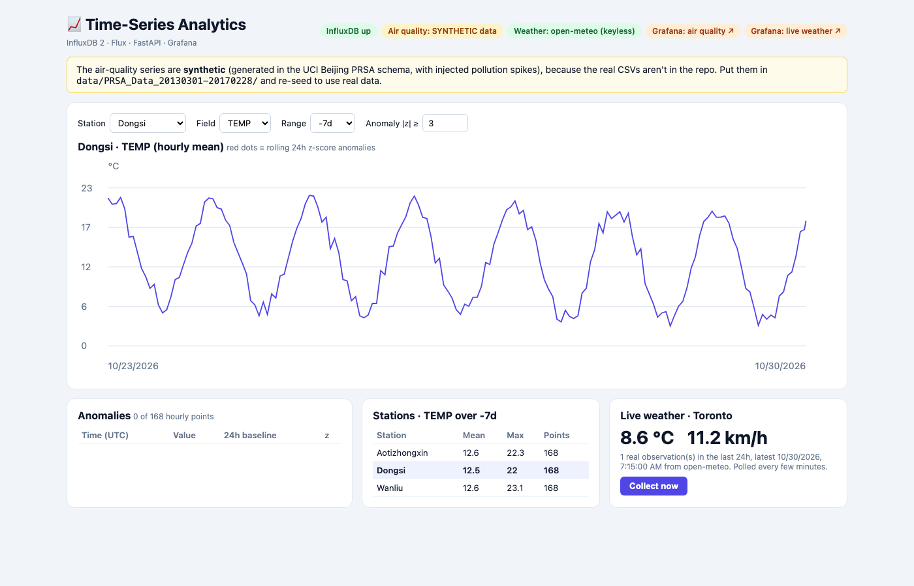

## 5. Grafana, provisioned as code

- `grafana/provisioning/datasources/influxdb.yml` sets up the Flux datasource. The token and org come from env.
- `grafana/dashboards/air-quality.json` has a `station` variable (from `schema.tagValues`), latest-PM2.5 stat tiles with AQI-style thresholds, PM2.5/PM10/temperature/wind/NO2-vs-O3 panels, and `aggregateWindow(v.windowPeriod)`.
- `grafana/dashboards/live-weather.json` holds the polled real observations and refreshes every 1 minute.

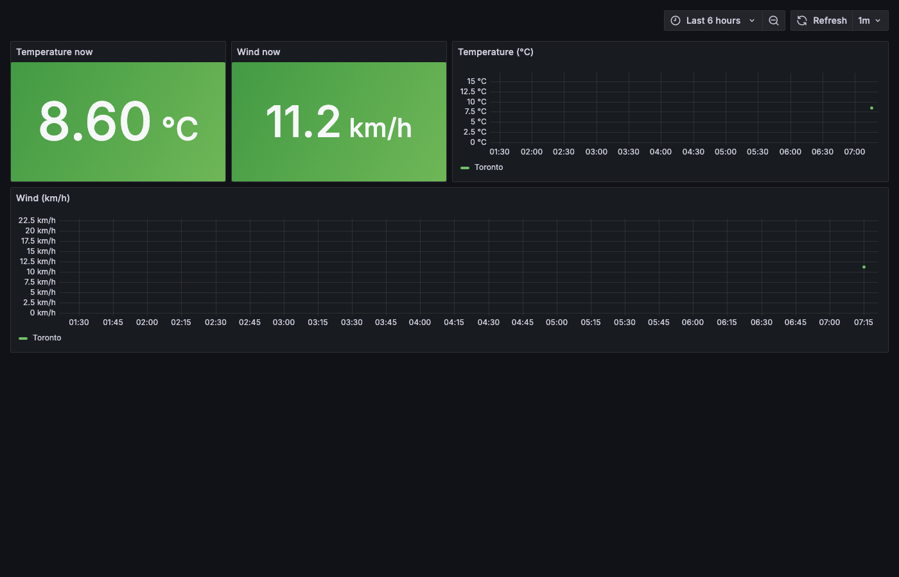

> ⚠️ **Honest data labels.** The air-quality values in these screenshots are **synthetic**: the generator follows the PRSA schema and injects pollution spikes. The console and `/health` (`air_quality_data`) say so. The weather values are **real Open-Meteo observations for Toronto**. The screenshot shows a single point because the stack had only just started (one poll every 5 minutes).

## 6. API

| Method | Path | Purpose |
|---|---|---|
| GET | `/health` | InfluxDB status, data mode (synthetic/real), weather source, last poll or error |
| GET | `/api/stations` | Station tags and fields |
| GET | `/api/series` | Hourly (or `every`) mean for a station and field |
| GET | `/api/anomalies` | Rolling z-score anomalies (`window`, `threshold`) |
| GET | `/api/summary` | Mean/max/count per station |
| GET / POST | `/api/weather`, `/api/weather/collect` | Read the live series / record one real observation (`502` and nothing written on failure) |

Query parameters are validated before they go into Flux (station pattern, field whitelist, `-7d`-style ranges).

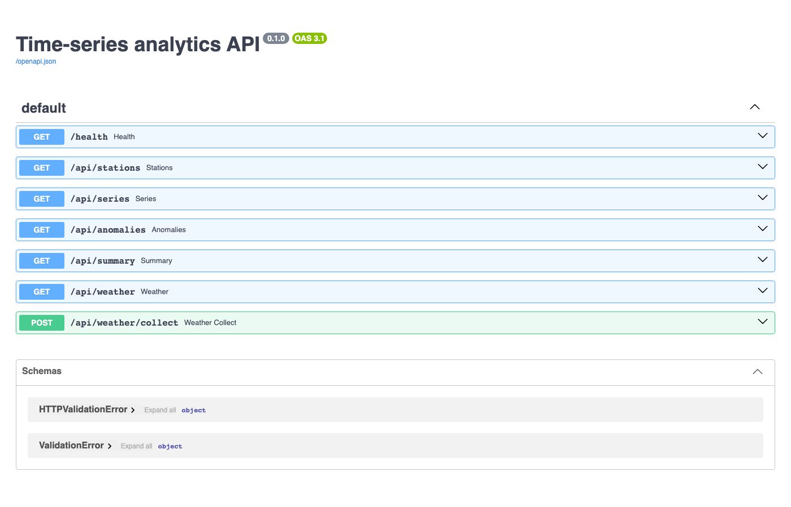

## Deploy to the cloud (Terraform)

`terraform/` has the same deployment for three clouds: **Google Cloud Run**, **Azure Container Apps** and **AWS ECS Express Mode**. Each is a root module that calls the shared modules in [ovokpus/GKE-Cluster-Management](https://github.com/ovokpus/GKE-Cluster-Management/tree/main/terraform), pinned to tag `tf-modules-v0.1.0`. Each folder deploys `grafana`, `api`, `frontend`, a `seed` job.

InfluxDB is **not** deployed. Point `influx_url` and `influx_token` at InfluxDB Cloud or another InfluxDB 2.x server. Grafana gets its datasource and dashboards from `grafana/Dockerfile`.

> [!CAUTION]
> **This costs real money.** On AWS, each ECS Express service runs at least one Fargate task plus a share of an Application Load Balancer, all the time. Cloud Run and Container Apps scale to zero, but their registries and logs still cost a little. Use a sandbox project or account, set a budget alert, and run `terraform destroy` when you finish. Database passwords are generated by Terraform, so they are also stored in its state file. Keep state somewhere private (each `versions.tf` has a commented remote backend).

CI (`.github/workflows/terraform.yml`) only runs `fmt`, `validate`, `tflint` and `checkov`. It never runs plan or apply.

### Google Cloud (Cloud Run)

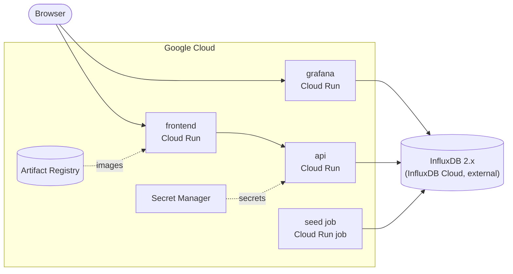

```bash
gcloud auth application-default login
gcloud config set project my-gcp-project
cd terraform/gcp
cp terraform.tfvars.example terraform.tfvars   # edit it
export TF_VAR_influx_token=...   # sensitive, keep out of files
export TF_VAR_grafana_admin_password=...   # sensitive, keep out of files
export TF_VAR_influx_url=...   # or set it in terraform.tfvars
terraform init

# 1. Create the registry first, then push the images
terraform apply -target=module.registry
REG=$(terraform output -raw registry)
gcloud auth configure-docker "${REG%%/*}"
cd ../..
docker build --platform linux/amd64 -t $REG/grafana:v1 grafana
docker push $REG/grafana:v1
docker build --platform linux/amd64 -t $REG/app:v1 .
docker push $REG/app:v1
docker build --platform linux/amd64 -t $REG/frontend:v1 frontend
docker push $REG/frontend:v1
cd terraform/gcp

# 2. Everything else
terraform apply

# 3. Open the app
terraform output frontend_url
terraform output grafana_url

# 4. Run the seed job once
eval "$(terraform output -raw seed_command)"

# Tear it all down
terraform destroy
```

### Azure (Container Apps)

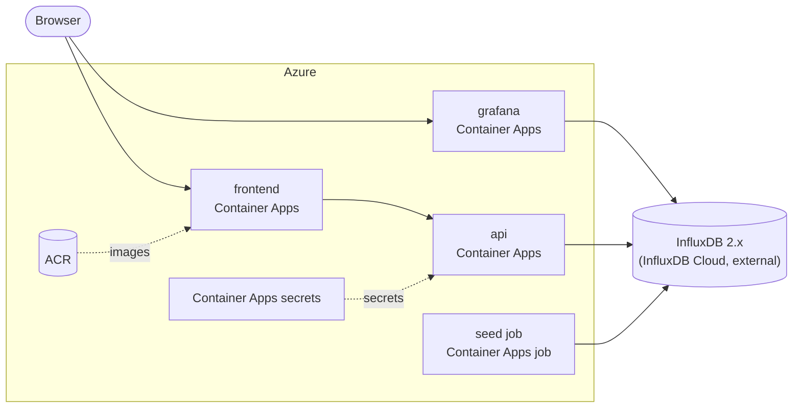

```bash
az login
az account set --subscription <subscription-id>
cd terraform/azure
cp terraform.tfvars.example terraform.tfvars   # edit it
# name_prefix must be globally unique (it names the registry): 3-20 lowercase letters/digits
export TF_VAR_influx_token=...   # sensitive, keep out of files
export TF_VAR_grafana_admin_password=...   # sensitive, keep out of files
export TF_VAR_influx_url=...   # or set it in terraform.tfvars
terraform init

# 1. Create the registry first, then push the images
terraform apply -target=module.acr
REG=$(terraform output -raw registry)
az acr login --name "${REG%%.*}"
cd ../..
docker build --platform linux/amd64 -t $REG/grafana:v1 grafana
docker push $REG/grafana:v1
docker build --platform linux/amd64 -t $REG/app:v1 .
docker push $REG/app:v1
docker build --platform linux/amd64 -t $REG/frontend:v1 frontend
docker push $REG/frontend:v1
cd terraform/azure

# 2. Everything else
terraform apply

# 3. Open the app
terraform output frontend_url
terraform output grafana_url

# 4. Run the seed job once
eval "$(terraform output -raw seed_command)"

# Tear it all down
terraform destroy
```

### AWS (ECS Express Mode)

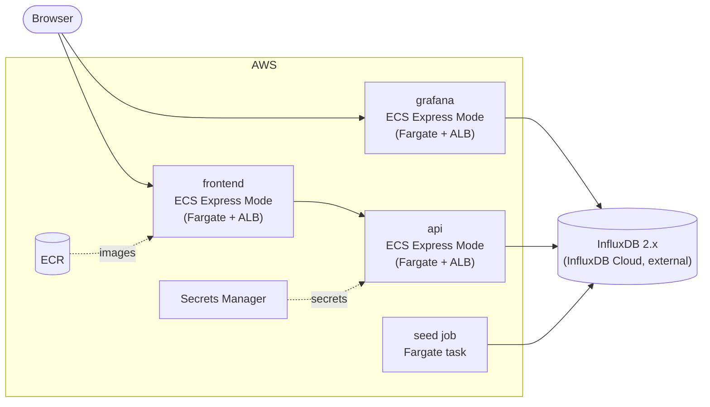

```bash
aws configure sso   # or any profile with admin rights in a sandbox account
export AWS_PROFILE=<profile>
cd terraform/aws
cp terraform.tfvars.example terraform.tfvars   # edit it
export TF_VAR_influx_token=...   # sensitive, keep out of files
export TF_VAR_grafana_admin_password=...   # sensitive, keep out of files
export TF_VAR_influx_url=...   # or set it in terraform.tfvars
terraform init

# 1. Create the registry first, then push the images
terraform apply -target=module.ecr
REG=$(terraform output -raw registry)
aws ecr get-login-password --region "${AWS_REGION:-us-east-1}" \
  | docker login --username AWS --password-stdin "$REG"
cd ../..
docker build --platform linux/amd64 -t $REG/tsa/grafana:v1 grafana
docker push $REG/tsa/grafana:v1
docker build --platform linux/amd64 -t $REG/tsa/app:v1 .
docker push $REG/tsa/app:v1
docker build --platform linux/amd64 -t $REG/tsa/frontend:v1 frontend
docker push $REG/tsa/frontend:v1
cd terraform/aws

# 2. Everything else
terraform apply

# 3. Open the app
terraform output frontend_url
terraform output grafana_url

# 4. Run the seed job once
eval "$(terraform output -raw seed_command)"

# Tear it all down
terraform destroy
```

## 7. What changed from the original scripts

- `src/*.py` were moved to `legacy/src/`. The logic now lives in `tsa/` (pure transforms, Influx I/O, seeder, weather).
- Bugs fixed:
  - `api_client.py` read a non-existent `src/config.json` and `config['bucket']`.
  - It stamped local time with a hard-coded `+12:00` offset.
  - `insert_data.py` passed the tag list as `data_frame_field_columns`, so no numeric fields were written to `test`.
- Compose: the deprecated `version: '2'` and `latest` image tags are gone, and the stale InfluxDB 1.x env vars in Grafana were dropped. Bind-mount data/config dirs (which needed `chmod -R 777 ~/`) became named volumes. A fixed local admin token is set, so nothing has to be copied by hand.
- `requirements.txt` was replaced by uv with `pyproject.toml` and `uv.lock`.
- The original README and screenshots are in [docs/ORIGINAL_README.md](docs/ORIGINAL_README.md). Batch-ingestion notes are in [docs/BESTPRACTICES.md](docs/BESTPRACTICES.md).

## 8. Quality

- `uv run pytest`: transforms (PRSA parsing, UTC handling, deterministic synthetic data, z-score), API (Flux-injection guards, anomaly maths, failed collection writes nothing, degraded health) and the Grafana provisioning files. No InfluxDB or network needed.
- CI: tests, then the frontend build, then `docker compose build`.
- `uv run --no-project --with playwright python scripts/screenshots.py` regenerates every screenshot from the running stack.
